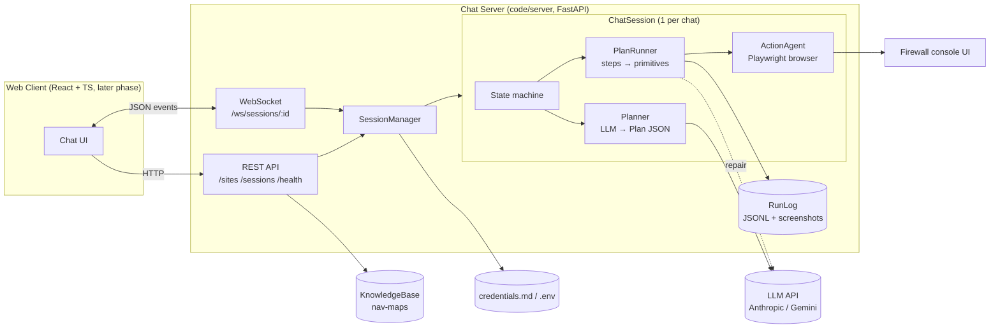
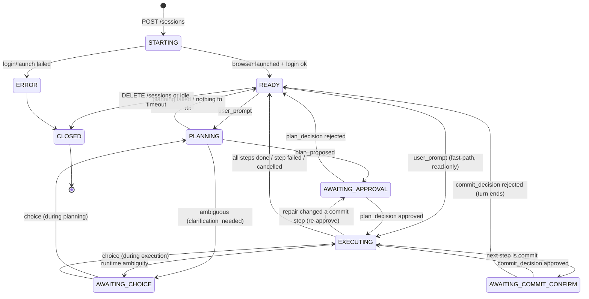
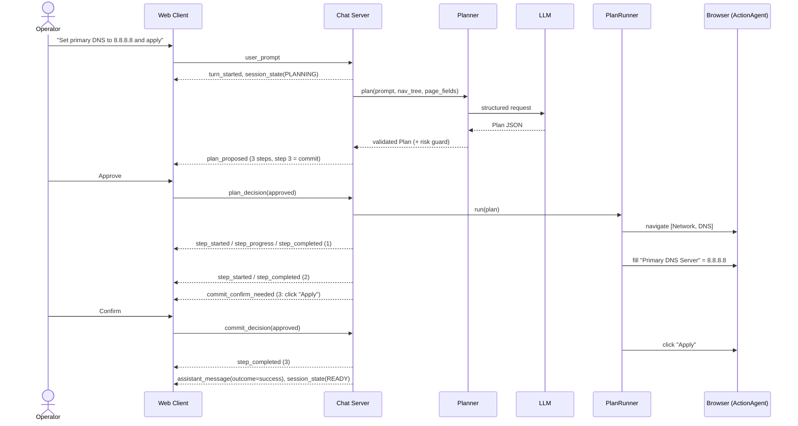
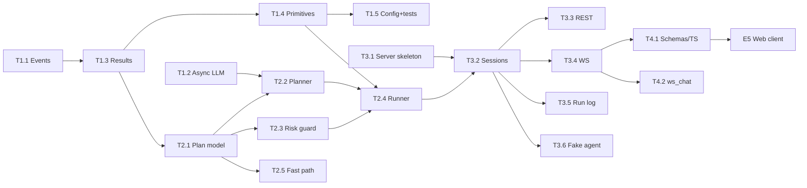

# Chat Executor — Design & Tasks

> Status: Draft v1 · Owner: Gal · Date: 2026-10-02
> Related: [Full solution HLD](Full%20solution%20HLD.md) · [README_WEB_AGENT](README_WEB_AGENT.md)

---

## 1. Context & Goals

Today the Executor (Agent 2, `ActionAgent`) is driven from the terminal: `python main.py execute --site-id …`
runs an `input()` loop that passes each line to `ActionAgent.execute_command()` and prints the result.

We want an **AI chat experience in a web client**:

- The operator types a prompt in a web chat, for example *"Create a static route to 10.0.0.0/24 via 192.168.1.1 and save it"*.
- The agent turns the prompt into a **multi-step plan** and shows it in the chat.
- The operator **approves** the plan, and the agent executes it in the browser.
- The operator sees **live progress** for each step and gets a final answer in the chat.
- The agent pauses for confirmation before any **commit** action (Save / Apply / OK / Delete…).

This document defines the backend changes, the client ↔ server protocol, and the developer task breakdown.
The React client is built **in a later phase**, from existing mockups. This document gives that team a stable
contract and a fake backend to build against.

### Goals
- G1: Accept prompts from a web client and stream responses and progress back.
- G2: Plan and execute **multi-step** tasks from a single prompt.
- G3: Require human approval of the plan and of every commit step.
- G4: Keep the existing CLI (`learn`, `execute`, `list`) working.
- G5: Give the frontend team a typed, documented protocol plus a fake-agent mode.

### Non-goals (this phase)
- Multi-user, authentication beyond a local token, or multi-tenant deployment.
- Sending conversation history to the LLM. **Each prompt is planned on its own.**
- The API/adapter execution path from the HLD (Path A). This phase is UI automation only (Path B).
- Automatic rollback of partially executed plans.
- Building the React client. It is outlined in §12, E5.

---

## 2. Decisions

| # | Decision | Rationale |
|---|---|---|
| D1 | **Python backend: FastAPI + uvicorn** in the existing `code/` project | Reuses `ActionAgent`, `KnowledgeBase` and `CredentialManager` directly. The HLD suggests Node/TS, but rewriting the working Playwright logic is not justified for this phase. |
| D2 | **Single operator, local**: bind `127.0.0.1`, up to `MAX_SESSIONS` (default 3) concurrent chat sessions | Matches the POC deployment. Each chat session owns one browser and one login. |
| D3 | **WebSocket per chat session** for prompts, decisions and streamed events. REST for sites and session lifecycle. | Bidirectional messages (approve, cancel, choose) mid-turn; SSE alone would not be enough. |
| D4 | **Plan → approve → execute** for every prompt that changes something | Firewalls are high-risk targets, and the operator must see the intent before anything is clicked. |
| D5 | **Hard confirm before each commit step**, decided by a **server-side guard** rather than only by the LLM | Defence in depth: an LLM label alone is not trusted for destructive actions. |
| D6 | **No chat history to the LLM.** Planning input is the current prompt, the nav-tree and the current page fields. | Predictable, cheaper and easier to test. Session state (current page, pending choices) still exists server-side. |
| D7 | **Site is picked in the UI** from learned nav-maps. **Credentials stay server-side** (`credentials.md` / `.env`). | Secrets never travel to or from the browser. |
| D8 | **Single process, single asyncio event loop** | Playwright async objects are bound to the loop that created them. With one operator and a few sessions, this is sufficient. |

---

## 3. Current State (as of this design)

| Area | Today | Problem for web chat |
|---|---|---|
| Entry point | `main.py` → `WebAgentCLI.run_executor()` → `input()` loop | Needs a server entry point |
| Executor API | `ActionAgent.start_session(creds)` → `execute_command(str) -> str` → `close_session()` | Reusable as-is ✅ |
| Session state | Per `ActionAgent`: `page`, login, `pending_paths`, `_pending_action` | Fine. One `ActionAgent` per chat session ✅ |
| Progress reporting | `print()` with emoji (`🖱 Clicked …`, `📋 Navigating …`) | No structured event channel to stream |
| Results | Plain strings; failure detected via `result.startswith("❌")` | Fragile, and the client cannot render state |
| Disambiguation | `_format_path_clarification()` returns "Type a number to choose." | Must become structured options |
| LLM calls | `_call_llm()` uses **sync** `Anthropic` / Gemini clients from async code | **Blocks the event loop**, which would freeze all sessions and WS traffic |
| Model | Hard-coded `claude-sonnet-4-20250514` | Must be configurable |
| Interpretation | `_interpret_with_llm()` returns **one** action (`navigate` / `action` / `navigate_and_act`) | Needs multi-step planning |
| Browser | `headless=False` hard-coded | Must be configurable |
| Tests | `tests/test_executor.py` targets the old schema-based API (`_find_element_by_name`, `PageSchema`) | Stale, needs a rewrite |

**Reusable primitives in `ActionAgent`.** These become plan-step actions:

| Primitive | Purpose |
|---|---|
| `_execute_path(path)` | Navigate the sidebar or top nav by labels, with built-in disambiguation |
| `_fill_field(target, value)` | Fill an input by label, placeholder or role |
| `_select_field_option(target, value)` | Native `<select>` or custom dropdown |
| `_click_page_element(target)` | Click a button or link on the page |
| `_click_near_label(btn, label)` | Click e.g. `+` next to a field label |
| `_select_table_row(n)` / `_select_table_row_by_text(text)` | Row selection in grids |
| `_perform_search(query)` | Search box |
| `_get_page_fields_summary()` | Visible fields, used as LLM grounding |
| `_all_paths(tree)` | All nav paths, used to validate plans |

Supporting code:

- `KnowledgeBase.list_available()` / `load_navmap()` / `navmap_to_text()` in `knowledge/storage.py`
- `CredentialManager.load_credentials()` in `knowledge/credentials.py`

---

## 4. Target Architecture



### Mapping to the HLD components

| HLD component | This design |
|---|---|
| Dashboard UI | React chat client (E5) |
| Command Parser | `Planner` (LLM → validated `Plan`) |
| Capability Router | Fixed to the UI path in this phase. `path_used="ui"` is recorded for future routing. |
| UI Automation Worker | `PlanRunner` + `ActionAgent` primitives |
| Site Model Store | `KnowledgeBase` nav-maps |
| Execution Log Store | `RunLog` (JSONL + failure screenshots) |

### New / changed modules

```
code/
  main.py                      # + "serve" subcommand
  executor/
    action_agent.py            # refactored: events, structured results, public primitives
    events.py                  # NEW  AgentEvent types + EventSink protocol
    results.py                 # NEW  StepResult / CommandResult / Clarification
    llm.py                     # NEW  async LLM client (Anthropic/Gemini), structured output helper
    plan.py                    # NEW  Plan / Step models + validation
    planner.py                 # NEW  prompt → Plan
    risk.py                    # NEW  commit-risk guard
    dispatcher.py              # NEW  Step.kind → ActionAgent primitive
    runner.py                  # NEW  PlanRunner (execute, re-ground, repair, pause, cancel)
    fastpath.py                # NEW  deterministic commands → one-step plans
  server/                      # NEW
    app.py                     # FastAPI app, lifespan, CORS, auth
    config.py                  # Settings (env)
    protocol.py                # WS envelope + message payload models
    sessions.py                # SessionManager, ChatSession, state machine
    routes_rest.py             # /health /sites /sessions
    routes_ws.py               # /ws/sessions/{id}
    runlog.py                  # ExecutionRecord persistence
    fake_agent.py              # FAKE_AGENT mode
  scripts/
    ws_chat.py                 # NEW  terminal WS client for manual E2E
    export_schemas.py          # NEW  JSON Schema export for TS type generation
  runs/                        # NEW  run logs (git-ignored)
```

---

## 5. Session Lifecycle & State Machine

A **chat session** = one `ChatSession` = one `ActionAgent` = one browser context logged into one site.
A **turn** = one user prompt and everything that follows until the session is `READY` again.



Rules:

- **One turn at a time per session.** A `user_prompt` in any state other than `READY` is rejected with `error{code:"busy"}`.
- `cancel` is accepted in `PLANNING`, `AWAITING_*` and `EXECUTING`. The runner stops **between** steps; a step already in progress is allowed to finish. The turn ends with `outcome:"cancelled"`.
- Waiting states have a timeout (`DECISION_TIMEOUT_SECONDS`, default 600). On timeout the turn ends as `cancelled`.
- An idle session (no turns for `SESSION_IDLE_MINUTES`, default 30) is closed and its browser released.
- Server shutdown closes all sessions gracefully (FastAPI lifespan hook).
- WS disconnects do **not** kill the session or the running turn. On reconnect, the server re-sends `session_state` and any pending request (`plan_proposed`, `commit_confirm_needed` or `clarification_needed`), so the client can restore its UI.

---

## 6. API Contract

### 6.1 REST

All endpoints accept the header `Authorization: Bearer <API_TOKEN>` when `API_TOKEN` is set.

| Method | Path | Request | Response |
|---|---|---|---|
| GET | `/health` | – | `{status:"ok", version, fake_agent:bool}` |
| GET | `/sites` | – | `[{site_id, site_url, nav_items, last_updated}]`. From `KnowledgeBase.list_available()` + `load_navmap()`. |
| POST | `/sessions` | `{site_id}` | `201 {session_id, status:"STARTING"}`. Browser launch and login run in the background, and progress is visible over WS. `404` unknown site, `409` `MAX_SESSIONS` reached, `400` missing credentials. |
| GET | `/sessions` | – | `[{session_id, site_id, status, created_at, last_activity}]` |
| GET | `/sessions/{id}` | – | `{session_id, site_id, status, current_url, created_at, last_activity}` |
| DELETE | `/sessions/{id}` | – | `204`. Cancels any running turn and closes the browser. |

### 6.2 WebSocket `/ws/sessions/{session_id}`

Auth: `?token=<API_TOKEN>` query parameter, because browsers cannot set headers on WS.

**Envelope (both directions):**

```json
{
  "type": "step_completed",
  "session_id": "s_8f2c",
  "turn_id": "t_0003",
  "message_id": "m_7a91",
  "ts": "2026-10-02T10:15:30.123Z",
  "payload": { }
}
```

`turn_id` is assigned by the server when a `user_prompt` is accepted. Client messages may omit `turn_id`,
`message_id` and `ts`.

#### Client → Server

| type | payload | Valid in state |
|---|---|---|
| `user_prompt` | `{text}` | READY |
| `plan_decision` | `{plan_id, approved: bool}` | AWAITING_APPROVAL |
| `commit_decision` | `{step_id, approved: bool}` | AWAITING_COMMIT_CONFIRM |
| `choice` | `{request_id, option_index}` (0-based) | AWAITING_CHOICE |
| `cancel` | `{}` | any busy state |
| `ping` | `{}` | any (server replies `pong`) |

#### Server → Client

| type | payload |
|---|---|
| `session_state` | `{status, site_id, current_url?}`. Sent on connect and on every transition. |
| `turn_started` | `{text}`. Echoes the accepted prompt. |
| `plan_proposed` | `{plan_id, summary, steps:[StepView], requires_approval:bool}` |
| `step_started` | `{step_id, index, description}` |
| `step_progress` | `{step_id, message, level:"info"\|"warn"}`. Fine-grained events from `ActionAgent`, e.g. "Clicked 'Network'". |
| `step_completed` | `{step_id, status:"success"\|"failed"\|"skipped", message, repaired:bool}` |
| `commit_confirm_needed` | `{step_id, description, target}` |
| `clarification_needed` | `{request_id, question, options:[{label, detail?}]}` |
| `assistant_message` | `{text, outcome:"success"\|"partial"\|"failed"\|"cancelled"\|"rejected"\|"info"}`. Ends the turn. |
| `error` | `{code, message, recoverable:bool}`. Codes: `busy`, `invalid_message`, `invalid_state`, `unknown_plan`, `llm_error`, `session_failed`, `unauthorized`. |
| `pong` | `{}` |

`StepView` = `{step_id, index, kind, description, risk:"read"|"write"|"commit", target?, value?, path?}`.
Values for password-like fields are shown as `"••••"`.

### 6.3 Example turn (happy path)



Message trace for the same turn:

```jsonc
// C → S
{"type":"user_prompt","payload":{"text":"Set primary DNS to 8.8.8.8 and apply"}}
// S → C
{"type":"plan_proposed","turn_id":"t_0003","payload":{
  "plan_id":"p_41","summary":"Set the primary DNS server to 8.8.8.8 and apply the change",
  "requires_approval":true,
  "steps":[
    {"step_id":"s1","index":1,"kind":"navigate","path":["Network","DNS"],"risk":"read","description":"Open Network → DNS"},
    {"step_id":"s2","index":2,"kind":"fill","target":"Primary DNS Server","value":"8.8.8.8","risk":"write","description":"Set Primary DNS Server to 8.8.8.8"},
    {"step_id":"s3","index":3,"kind":"click","target":"Apply","risk":"commit","description":"Click Apply"}]}}
// C → S
{"type":"plan_decision","payload":{"plan_id":"p_41","approved":true}}
// S → C  (…step events…)
{"type":"commit_confirm_needed","payload":{"step_id":"s3","description":"Click Apply","target":"Apply"}}
// C → S
{"type":"commit_decision","payload":{"step_id":"s3","approved":true}}
// S → C
{"type":"assistant_message","payload":{"outcome":"success",
  "text":"Done: Set the primary DNS server to 8.8.8.8 and apply the change.\n✓ Open Network → DNS\n✓ Set Primary DNS Server to 8.8.8.8\n✓ Click Apply"}}
```

---

## 7. Plan Model & Planning

### 7.1 Models (`executor/plan.py`, pydantic)

```python
class StepKind(str, Enum):
    navigate = "navigate"        # path: list[str]
    fill = "fill"                # target, value
    select = "select"            # target, value
    click = "click"              # target
    click_near = "click_near"    # target (e.g. "+"), near (field label)
    select_row = "select_row"    # value: row number or text
    search = "search"            # value
    verify = "verify"            # target: text/field expected on page (read-only check)

class Risk(str, Enum):
    read = "read"; write = "write"; commit = "commit"

class Step(BaseModel):
    id: str
    kind: StepKind
    description: str
    path: list[str] | None = None
    target: str | None = None
    value: str | None = None
    near: str | None = None
    risk: Risk = Risk.write

class Plan(BaseModel):
    plan_id: str
    summary: str
    steps: list[Step]                       # 1..MAX_PLAN_STEPS (default 15)
    clarification: Clarification | None = None   # planner may ask instead of planning
```

**Validation** (`Plan.validate_against(navmap)`):

- Required fields per kind. For example, `navigate` needs `path` and `fill` needs `target` + `value`.
- Every `navigate.path` must exist in `ActionAgent._all_paths(navmap.nav_tree)`. If a path ends in a label that appears under several parents, the validator converts it into a `clarification`, reusing today's disambiguation logic.
- The step count must be within `MAX_PLAN_STEPS`.
- If validation fails, the planner retries once with the validation errors appended. After that the turn ends with `assistant_message(outcome="failed")`.

### 7.2 Planner (`executor/planner.py`)

Input:

- the current prompt only (D6)
- `KnowledgeBase.navmap_to_text(navmap)`
- `ActionAgent._get_page_fields_summary()`
- the current URL / last navigated path

Output: a `Plan`, obtained through **structured output** (Anthropic tool use with the `Plan` JSON Schema, or the Gemini
`response_schema`). Free-text parsing is not used. `_extract_json()` stays only as a fallback.

The prompt keeps the existing rules from `_interpret_with_llm()`: exact nav labels, field vs. menu
distinction, and dropdown items treated as clicks. It extends them for multi-step output:

- Steps must use only the kinds listed above. One UI action per step.
- Fields that are not yet visible (because they live on a page navigated to earlier in the plan) may be referenced by
  their expected label. The runner re-grounds them at execution time (§8.2).
- Set `risk="commit"` for any step that persists, applies, deletes or confirms.
- If the request is ambiguous or unsupported, return `clarification` instead of guessing.

### 7.3 Commit-risk guard (`executor/risk.py`)

This runs on the server after the LLM and **can only raise risk, never lower it**.

- `click`/`click_near` whose target matches (case-insensitive, whole word) any of
  `save, apply, ok, delete, remove, commit, submit, confirm, install, reboot, restart, revert, push, deploy, yes`
  becomes `commit`. The list can be extended via the `COMMIT_KEYWORDS` env setting.
- `fill`/`select`/`select_row` that is labelled `read` is raised to `write`.
- `navigate`, `search` and `verify` stay `read`.

**Approval rule:** `requires_approval = any(step.risk != read)`. A read-only plan, such as "go to DNS", runs immediately.

---

## 8. Execution Semantics

### 8.1 Dispatcher (`executor/dispatcher.py`)

This module maps `Step` to a public `ActionAgent` primitive and returns a `StepResult`:

| kind | ActionAgent call |
|---|---|
| navigate | `navigate(path)` (was `_execute_path`) |
| fill | `fill_field(target, value)` |
| select | `select_option(target, value)` |
| click | `click_element(target)` |
| click_near | `click_near_label(target, near)` |
| select_row | `select_row(int)` or `select_row_by_text(str)` |
| search | `search(value)` |
| verify | `verify_visible(target)` (NEW, small: text or field present on page) |

### 8.2 PlanRunner (`executor/runner.py`)

```
for step in plan.steps:
    check cancel flag → stop (outcome=cancelled)
    if step.risk == commit and CONFIRM_COMMIT_STEPS:
        emit commit_confirm_needed; await decision → if rejected: stop (outcome=rejected)
    emit step_started
    if step.kind in {fill, select, click, click_near}:
        refresh page fields (re-grounding snapshot, used by repair)
    result = dispatcher.run(step)
    if result.status == NEEDS_CHOICE:        # e.g. nav label ambiguous at runtime
        emit clarification_needed; await choice; re-run with chosen option
    if result.status == FAILED and repair_budget > 0:
        repaired = planner.repair(step, error, page_fields)   # one LLM call
        if repaired changes kind/adds commit risk: require re-approval of that step
        result = dispatcher.run(repaired)
    emit step_completed
    if result.status == FAILED: screenshot → runlog; stop (outcome=partial|failed)
    settle delay (existing 1.0s after navigation)
emit assistant_message
```

- **Repair** is limited to **one attempt per step** and **at most 3 per turn**. A repair may only change `target`, `value`, `path` or `near` of the *current* step. It may not add steps or change any other step. If the repaired step's risk is higher than the approved one, the runner asks for approval again.
- **No rollback.** On failure the response lists what was done and what was not, so the operator can decide what to do next.
- **Final message** is built from a template using `plan.summary` and the step outcomes, ✓ / ✗ / – per step. No extra LLM call is made.

### 8.3 Fast path (`executor/fastpath.py`)

The existing deterministic commands in `execute_command()` are preserved, run without planning, and become one-step plans:

| Pattern | Behavior |
|---|---|
| `fields` / `list fields` / `dump fields` / `dump rows` / `dump dropdown` | Diagnostic, read-only, executes immediately and returns the dump as `assistant_message(outcome="info")` |
| `click at X Y` | One `click` step at the coordinates. Treated as `write` and requires approval. |
| `select row N` / `select row containing X` | One `select_row` step, treated as `write` |
| `click X in/near Y` | One `click_near` step. The commit guard still applies. |

The old numeric reply to disambiguation (`"2"`) is replaced by the structured `choice` message.

---

## 9. Executor Refactor Details

### 9.1 Events (`executor/events.py`)

```python
class AgentEvent(BaseModel):
    kind: Literal["progress", "warning", "login", "navigated"]
    message: str
    data: dict = {}

EventSink = Callable[[AgentEvent], Awaitable[None]]
```

- The `ActionAgent.__init__` signature becomes `(..., on_event: EventSink | None = None, headless: bool = False)`.
- Every progress `print()` in `action_agent.py` is replaced by `await self._emit(kind, message, **data)`.
- The default sink prints the same emoji lines, so **CLI output is unchanged**.
- The server's sink wraps events into `step_progress` for the current step.

### 9.2 Results (`executor/results.py`)

```python
class Status(str, Enum):
    success = "success"; failed = "failed"; needs_choice = "needs_choice"

class Clarification(BaseModel):
    question: str
    options: list[ClarificationOption]       # label, detail, payload (e.g. nav path)

class StepResult(BaseModel):
    status: Status
    message: str
    clarification: Clarification | None = None
    data: dict = {}
```

- All primitives return `StepResult`. Every `startswith("❌")` check is removed.
- `_format_path_clarification()` is replaced by building a `Clarification`.
- `execute_command(str) -> str` is kept as a thin CLI-compat wrapper that runs plan → auto-approve → run and formats the result as text. The CLI keeps today's behavior. Optionally, the CLI can later show the plan and ask `y/n`.

### 9.3 LLM client (`executor/llm.py`)

- Async only: `anthropic.AsyncAnthropic` and Gemini `generate_content_async`.
- `async def structured(prompt: str, schema: type[BaseModel]) -> BaseModel`: tool use / response schema → validated model.
- Config: `LLM_PROVIDER` (auto: Anthropic first, then Gemini, as in `main.py`), `LLM_MODEL` (default a current Sonnet model, e.g. `claude-sonnet-5-5`), `LLM_TIMEOUT_SECONDS` (default 60), `LLM_MAX_TOKENS`.
- **No LLM configured:** the planner falls back to `_interpret_basic()`, wrapped into a one-step plan. The server starts with a warning, and `/health` reports `llm:false`.

---

## 10. Security, Config, Logging

### 10.1 Security

- Bind `HOST=127.0.0.1` by default. Binding to another interface logs a warning.
- `API_TOKEN` (optional but recommended) is checked on REST (Bearer) and WS (`?token=`). Comparison is constant-time.
- CORS allow-list from `CORS_ORIGINS` (default `http://localhost:5173` for the Vite dev server).
- Credentials are loaded server-side via `CredentialManager.load_credentials()` and **never** included in any response or event.
- Redaction: values for steps whose target matches `password|secret|key|token|psk` are replaced by `••••` in events, the run log and the plan view. The real value is used only in the browser.
- Prompt text is untrusted. The planner output is constrained by schema and validation, and commit steps are always gated by the server-side guard.

### 10.2 Configuration (`server/config.py`, pydantic-settings, `.env`)

| Variable | Default | Purpose |
|---|---|---|
| `HOST` / `PORT` | `127.0.0.1` / `8000` | Bind address |
| `API_TOKEN` | – | Optional shared token |
| `CORS_ORIGINS` | `http://localhost:5173` | Comma-separated list |
| `HEADLESS` | `false` | Browser visibility (visible helps during the POC) |
| `MAX_SESSIONS` | `3` | Concurrent chat sessions |
| `SESSION_IDLE_MINUTES` | `30` | Idle reaper |
| `DECISION_TIMEOUT_SECONDS` | `600` | Waiting-state timeout |
| `CONFIRM_COMMIT_STEPS` | `true` | Hard confirm per commit step |
| `COMMIT_KEYWORDS` | – | Extra commit keywords |
| `MAX_PLAN_STEPS` | `15` | Plan size cap |
| `LLM_PROVIDER` / `LLM_MODEL` / `LLM_TIMEOUT_SECONDS` | auto / Sonnet / `60` | LLM |
| `RUNS_DIR` | `runs` | Run log directory |
| `FAKE_AGENT` | `false` | Scripted backend for frontend development |

### 10.3 Run log (`server/runlog.py`)

There is one JSON line per turn in `runs/<session_id>.jsonl`. It aligns with the HLD `ExecutionRecord`:

```json
{"run_id":"t_0003","session_id":"s_8f2c","site_id":"fortinet_aws","prompt":"…",
 "plan":{…},"decisions":[{"type":"plan","approved":true,"ts":"…"},{"type":"commit","step_id":"s3","approved":true}],
 "steps":[{"step_id":"s1","status":"success","started":"…","ended":"…","repaired":false}],
 "outcome":"success","path_used":"ui","artifacts":["runs/s_8f2c/t_0003_s2.png"],
 "started":"…","ended":"…"}
```

- A screenshot (`page.screenshot()`) is captured on every failed step.
- Values are redacted as in §10.1.
- `runs/` is added to `.gitignore`.

---

## 11. Testing Strategy

| Level | What | How |
|---|---|---|
| Unit | Plan validation (kinds, required fields, nav paths) | pytest with nav-maps from `knowledge/schemas/*.json` |
| Unit | Commit-risk guard | Table-driven pytest |
| Unit | Dispatcher / runner (pause, cancel, repair budget, failure stop) | pytest-asyncio with a fake `ActionAgent` and a fake LLM |
| Unit | Planner output parsing / retry on validation error | Mocked `llm.structured` |
| API | REST + WS protocol, state transitions, busy rejection, reconnect re-send | FastAPI `TestClient` WebSocket in `FAKE_AGENT=true` mode |
| Regression | CLI `execute` still works | Manual: `python main.py execute --site-id fortinet_aws` |
| E2E (manual) | Real firewall, real LLM | `python main.py serve` + `python scripts/ws_chat.py --site fortinet_aws`. Run the scenario checklist: navigate-only, fill+apply, ambiguous label, reject plan, reject commit, cancel mid-run, failing step with repair. |

---

## 12. Task Breakdown

Estimates: **S** ≤ 1 day, **M** 2–3 days, **L** 4–5 days. "Deps" lists tasks that must be done first.

### E1 — Executor refactor (prerequisite; CLI must keep working)

**T1.1 Event emitter** · S · Deps: –
- Add `executor/events.py` (`AgentEvent`, `EventSink`, default print sink).
- Inject `on_event` into `ActionAgent`. Replace progress `print()` calls in `action_agent.py` with `_emit()`.
- **AC:** CLI output is visually unchanged. A unit test with a capturing sink receives events for navigate/fill/click.

**T1.2 Async LLM client** · M · Deps: –
- Add `executor/llm.py` with provider auto-select, `LLM_MODEL`, timeout, and `structured(prompt, schema)`.
- Remove the sync `_call_llm`. `_interpret_with_llm` uses the new client.
- **AC:** No sync LLM call remains (`grep "messages.create("` only inside `llm.py` with `await`). A unit test with a mocked client returns a validated model. A timeout raises `LLMError`.

**T1.3 Structured results & clarifications** · M · Deps: T1.1
- Add `executor/results.py`. All primitives return `StepResult`. Disambiguation returns a `Clarification`.
- Keep the `execute_command() -> str` compat wrapper.
- **AC:** No `startswith("❌")` remains. The CLI shows the same messages. A test covers the ambiguous-label path returning `needs_choice` with options.

**T1.4 Public primitives + `verify_visible`** · S · Deps: T1.3
- Rename or expose the primitives listed in §8.1 as public methods (keep private aliases if needed). Add `verify_visible(target)`.
- **AC:** The dispatcher uses only public methods.

**T1.5 Config + test cleanup** · S · Deps: T1.1–T1.4
- `headless` parameter / `HEADLESS` env setting. Rewrite the stale `tests/test_executor.py` against the current nav-map API with a mocked `Page`.
- **AC:** `pytest` passes.

### E2 — Planner & runner

**T2.1 Plan models + validation** · M · Deps: T1.3
- `executor/plan.py` per §7.1, including nav-path validation via `_all_paths` and conversion of ambiguity to clarification.
- **AC:** Unit tests cover each kind's required fields, an unknown nav path, an ambiguous label (Fortinet nav-map) and the max-steps limit.

**T2.2 Planner** · M · Deps: T1.2, T2.1
- `executor/planner.py`: prompt per §7.2, structured output, one retry with validation errors, and fallback to `_interpret_basic` when no LLM is configured.
- **AC:** With a mocked LLM, a valid plan returns a `Plan` and an invalid-then-valid plan succeeds on retry. A manual test with the real LLM against the Fortinet nav-map produces sensible plans for 5 sample prompts (list included in the PR).

**T2.3 Commit-risk guard** · S · Deps: T2.1
- `executor/risk.py` per §7.3.
- **AC:** A table-driven test covers that the guard only raises risk, the `COMMIT_KEYWORDS` extension works, and `requires_approval` is computed correctly.

**T2.4 PlanRunner** · L · Deps: T1.4, T2.1–T2.3
- `executor/dispatcher.py` + `executor/runner.py` per §8.1–8.2.
- Decisions are awaited through an injectable `DecisionProvider` (async futures) so the server and tests can drive it.
- **AC:** Tests with a fake agent cover success, failure stop, cancel between steps, commit reject, runtime choice, repair success, repair budget exhausted, and repair risk escalation triggering re-approval.

**T2.5 Fast path** · S · Deps: T2.1
- `executor/fastpath.py` per §8.3, moving the regex logic out of `execute_command()`.
- **AC:** Each pattern maps to the expected one-step plan. Diagnostics run without approval.

### E3 — Chat server

**T3.1 Server skeleton** · S · Deps: –
- `server/app.py`, `server/config.py`: FastAPI app, lifespan, CORS, token auth dependency, `/health`.
- Add `python main.py serve [--host --port]` running uvicorn with **1 worker**.
- **AC:** `/health` responds. Requests without a valid token get `401` when `API_TOKEN` is set.

**T3.2 SessionManager + ChatSession** · L · Deps: T2.4, T3.1
- `server/sessions.py`: create (load nav-map + credentials, background `start_session`), state machine per §5, per-session turn lock, decision futures, cancel, idle reaper task, `MAX_SESSIONS`, and close-all on shutdown.
- **AC:** Unit tests cover legal and illegal transitions, busy rejection, the idle timeout closing a session, and shutdown closing all browsers.

**T3.3 REST endpoints** · S · Deps: T3.2
- `server/routes_rest.py` per §6.1.
- **AC:** `TestClient` tests for every endpoint and error code.

**T3.4 WebSocket handler** · M · Deps: T3.2
- `server/protocol.py` (pydantic envelope + payload models per §6.2) and `server/routes_ws.py`: parse and validate client messages, route them to the session, and fan out events to all sockets connected to that session. Reconnect re-sends state and any pending request. Ping/pong.
- **AC:** WS tests in `FAKE_AGENT` mode cover the full happy path (§6.3 trace), invalid message → `error{invalid_message}`, wrong-state message → `error{invalid_state}`, and disconnect plus reconnect during `AWAITING_APPROVAL` re-sending `plan_proposed`.

**T3.5 Run log** · S · Deps: T3.2
- `server/runlog.py` per §10.3: screenshots on failure, redaction, and `runs/` added to `.gitignore`.
- **AC:** One JSONL line per turn. A secret value never appears in the file (tested).

**T3.6 FAKE_AGENT mode** · M · Deps: T3.2
- `server/fake_agent.py`: a scripted planner and agent with no browser or LLM, deterministic and with realistic delays. Prompts containing `ambiguous`, `fail` or `apply` trigger the clarification, failure and commit flows.
- **AC:** The frontend can exercise every message type without a firewall. Used by the T3.4 tests.

### E4 — Contract, tooling, docs

**T4.1 Protocol spec + TS types** · S · Deps: T3.4
- `scripts/export_schemas.py` dumps JSON Schemas for all protocol models to `code/server/schemas/`. Document generating TS types with `json-schema-to-typescript` for the React app.
- **AC:** Schemas are committed. A sample generated `protocol.ts` compiles.

**T4.2 Terminal WS client** · S · Deps: T3.4
- `scripts/ws_chat.py`: pick a site, create a session, chat, render events, and answer approve/confirm/choice prompts interactively.
- **AC:** All E2E scenarios in §11 can be run with it.

**T4.3 Dependencies & docs** · S · Deps: E3
- `requirements.txt`: add `fastapi`, `uvicorn[standard]`, `pydantic-settings`, `httpx` (tests). **Note:** `pydantic==2.5.3` may need a bump for compatibility with current FastAPI; verify.
- Update `README.md` / `QUICKSTART.md` with a "Chat server" section and `.env.example` with the new variables.
- **AC:** A fresh venv install followed by `python main.py serve` works.

### E5 — Web client (later phase; outline only)

Built in React + TS from the existing mockups against the protocol in §6. Detailed tasks will be written once the mockups are reviewed. The expected building blocks are:

| UI element | Protocol |
|---|---|
| Site picker / new chat | `GET /sites`, `POST /sessions` |
| Connection & session status badge | `session_state` |
| Chat transcript (user bubbles, assistant bubbles) | `turn_started`, `assistant_message` |
| Plan approval card (steps, risk badges, Approve / Cancel) | `plan_proposed` → `plan_decision` |
| Live step list (spinner / ✓ / ✗, expandable progress log) | `step_started`, `step_progress`, `step_completed` |
| Commit confirmation dialog | `commit_confirm_needed` → `commit_decision` |
| Clarification options (buttons) | `clarification_needed` → `choice` |
| Stop button | `cancel` |
| Reconnect handling | WS reconnect + state re-sync |

Development runs against `FAKE_AGENT=true`, using the TS types from T4.1.

### Dependency graph



Parallelization: T1.1, T1.2 and T3.1 can start on day 1. T3.6 can start against the protocol models before T2.4 is finished, which unblocks the frontend early.

---

## 13. Milestones

| Milestone | Contents | Exit criteria |
|---|---|---|
| **M1 — Executor ready** | E1, T2.1, T2.3 | CLI works on the refactored agent. Events and structured results are in place. Plan model and risk guard are tested. |
| **M2 — Chat backend** | T2.2, T2.4, T2.5, E3 | Full turn via `ws_chat.py` against a real firewall: plan → approve → steps → commit confirm → answer. |
| **M3 — Client-ready** | E4 | Schemas and TS types published. `FAKE_AGENT` documented. The frontend team can start E5. |

Rough effort for E1–E4: one developer about 4–5 weeks, or two developers (executor track + server track) about 2.5–3 weeks.

---

## 14. Risks & Open Questions

### Risks

| Risk | Impact | Mitigation |
|---|---|---|
| LLM plans reference fields that only exist after navigation, with the wrong labels | Step failures | Re-grounding before each step, a single targeted repair, and clear failure reporting |
| LLM mislabels a destructive action as non-commit | Unintended change | Server-side keyword guard (raise-only), plan approval, per-commit confirm |
| Console UI changes (vendor upgrade) break primitives | Failures | Failure screenshots in the run log. Re-run the learner. HLD selector-hardening (`data-testid`). |
| Partial execution leaves config half-applied | Inconsistent device state | No auto-rollback (explicit). The final message lists completed and not-completed steps. Commit steps are usually last. |
| Single event loop: a blocking call freezes all sessions | Server hangs | T1.2 removes sync LLM calls. Code review rule: no sync I/O in the executor or server. |
| Planning latency (LLM call plus page snapshot) | Slow UX | Streamed `session_state(PLANNING)`. Fast path for deterministic commands. Read-only plans skip approval. |
| Multiple browsers on one machine | Resource usage | `MAX_SESSIONS`, idle reaper |

### Open questions

1. **Run log retention.** How long should runs and screenshots be kept, and is there an audit requirement (immutable logs per the HLD)?
2. **Multi-user / remote access later.** Which identity provider is used, and do operators share firewall credentials or have their own?
3. **Commit keyword list per vendor.** Should Fortinet and Palo Alto have their own lists (e.g. Palo Alto's "Commit" vs. Fortinet's "OK")? Could these be stored in the nav-map?
4. **Read-only answers.** Should the agent also *answer questions* from page content (e.g. "what is the current DNS?"), using an LLM summary of the page? That would be a natural follow-up step kind (`read`).
5. **API path (HLD Path A).** When adapters exist, the planner/router should prefer API steps. Is `path_used` in the run log enough to prepare for that?
