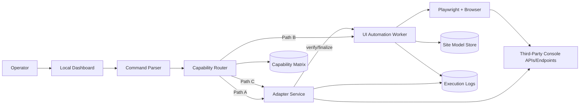
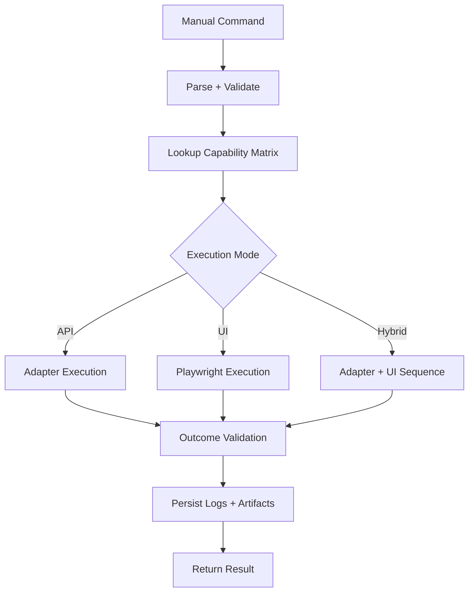
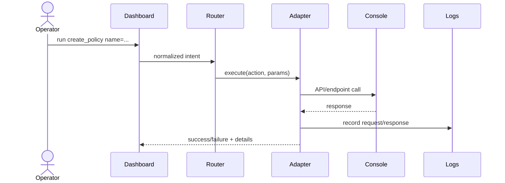
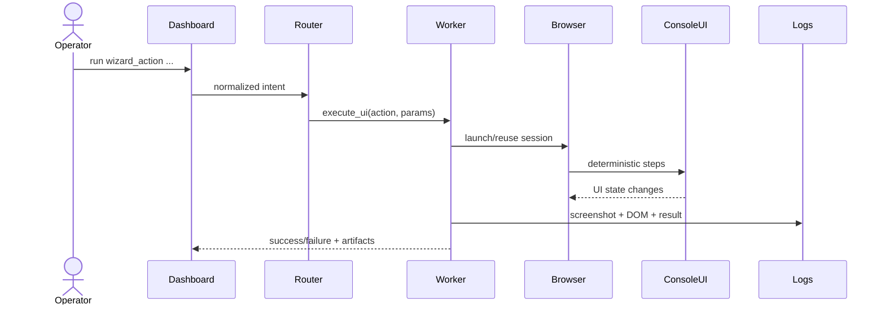
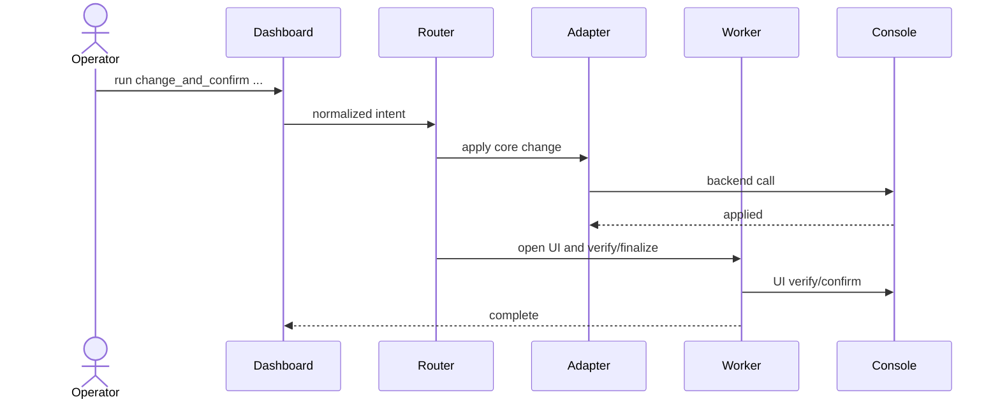
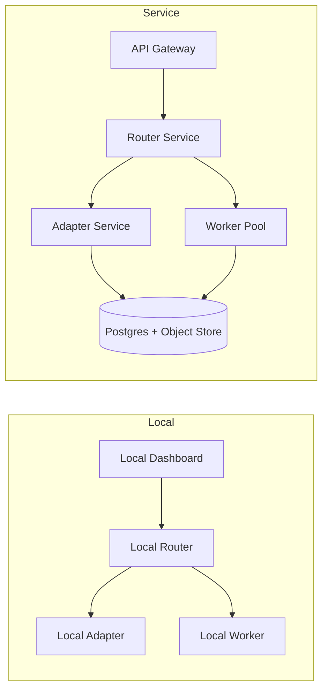

# Full Solution HLD

## Document Scope
High-level design for a local automation agent that operates a third-party console web app in your network, with a forward path to service deployment.

## Deployment Context
- Product ownership: `No` (third-party product)
- Deployment control: `Yes` (you can modify deployed web assets in your network)
- Automation permissions: `Required` before rollout
- Primary requirement: build your own dashboard to execute actions in the console

## Control Level Classification
- You do not own product source or API roadmap.
- You can change deployed console behavior in your environment.
- You can inject stable UI attributes (`data-testid`, `aria-label`) for robust automation.
- You can deploy a sidecar/reverse-proxy adapter in the same network segment.

## Objectives
- Execute user-issued commands reliably against the target console.
- Prefer stable integration paths over brittle UI selectors.
- Retain UI automation for unsupported product capabilities.
- Keep architecture compatible with future service deployment.

## Non-Objectives
- General autonomous web agent across arbitrary sites.
- Any bypass of product security controls or policy boundaries.
- Deep LLM-driven autonomous planning in v1.

## Architecture Decision
Use a hybrid model with API/adapter first and UI automation fallback.

Execution path priority:
1. `Path A` (Primary): Adapter/API execution
2. `Path B` (Fallback): Playwright UI execution
3. `Path C` (Hybrid): API for core change + UI verification/finalization

## Logical Components
- Dashboard UI: operator-facing local dashboard
- Command Parser: parses manual commands into normalized intents
- Capability Router: selects API, UI, or Hybrid path per action
- Adapter Service (local sidecar or reverse proxy): normalized operations, auth/session handling, retries, audit
- UI Automation Worker: Playwright-based deterministic runner
- Site Model Store: pages/elements/actions/selectors
- Capability Matrix Store: per-action support and owner
- Execution Log Store: request/response traces, screenshots, outcomes

## Component Diagram

## Runtime Stack (Local)
- Node.js (TypeScript preferred)
- Playwright (Chromium)
- SQLite (initial), optional Postgres later
- Local dashboard (web app) + local API process

## Data Model
### `ActionDefinition`
- `action_id`
- `name`
- `intent_schema` (required parameters)
- `execution_mode` (`api`, `ui`, `hybrid`)
- `owner` (`platform`, `automation`)
- `risk_level`

### `ActionStep`
- `step_id`
- `action_id`
- `type` (`api_call`, `click`, `fill`, `select`, `wait`, `assert`)
- `target`
- `value_template`
- `retry_policy`

### `ElementSelector`
- `element_id`
- `page_fingerprint`
- `primary_selector`
- `fallback_selectors[]`
- `version`

### `ExecutionRecord`
- `run_id`
- `action_id`
- `input_payload`
- `path_used`
- `status`
- `artifacts` (screenshot, DOM snapshot, logs)
- `timestamps`

## Capability Matrix
Use this as the routing authority.

| Action | API-supported | UI-only | Hybrid | Risk | Owner |
|---|---|---|---|---|---|
| Login session refresh | Yes | No | No | Low | Platform |
| Create object X | Partial | No | Yes | Medium | Platform |
| Trigger console wizard Y | No | Yes | No | Medium | Automation |
| Bulk status read | Yes | No | No | Low | Platform |
| Final approval step | No | Yes | Yes | High | Automation |

## Control Plane Flow
1. Operator sends manual command from dashboard.
2. Parser validates syntax and required fields.
3. Router checks capability matrix.
4. Route to API/UI/Hybrid executor.
5. Validator checks outcome criteria.
6. Persist full execution record and artifacts.

## Flow Diagram

## Sequence: API-Primary Action

## Sequence: UI Fallback Action

## Sequence: Hybrid Action

## Selector Hardening Strategy
Since deployment is modifiable, enforce testability attributes.

Priority order:
1. `data-testid`
2. `aria-label`
3. role + visible label text
4. stable CSS
5. XPath (last resort)

Rules:
- Every actionable control gets stable `data-testid`.
- Keep selectors versioned per console release.
- Fail closed when neither primary nor fallback selectors match.

## Adapter Design
Responsibilities:
- Session and token handling
- Endpoint normalization for dashboard use
- Request throttling and retry
- Policy checks and authorization hooks
- Standardized audit logging

Deployment options:
- Reverse proxy in front of console endpoints
- Sidecar service adjacent to dashboard

## Security and Compliance
- Respect product licensing and vendor terms.
- Separate operator identity from automation identity where possible.
- Store secrets in OS keychain or encrypted vault.
- Emit immutable audit events for sensitive actions.

## Reliability and Recovery
- Idempotency keys for API-capable actions.
- Retry strategy with bounded backoff.
- UI fallback only for explicit matrix-approved actions.
- Capture screenshot + DOM snapshot on UI failures.

## Migration Path: Local to Service
This design is service-ready because routing and execution are already separated.

Local mode:
- Dashboard + Router + Adapter + Worker on one host.

Service mode:
- Dashboard (web) -> API Gateway -> Router Service -> Worker Pool / Adapter Service.

## Migration Diagram

## MVP Phases
1. Build parser + capability matrix + router skeleton.
2. Implement adapter for 2-3 high-value actions.
3. Implement UI worker for 1 unsupported action.
4. Add logs, artifacts, and validation policies.
5. Add hybrid actions and release gates.

## Acceptance Criteria
- 95%+ success for API-primary actions in controlled environment.
- Deterministic fallback behavior for matrix-approved UI actions.
- All runs have traceable logs and artifacts.
- Action onboarding path is documented (API, UI, or Hybrid).

## Open Risks
- Vendor UI releases can still break selectors without release notice.
- Network segmentation/policy may limit adapter deployment model.
- Some high-risk actions may require human approval step by policy.

## Immediate Next Implementation Items
1. Define first 10 actions and fill capability matrix.
2. Implement adapter contract (`/actions/:id/execute`).
3. Implement Playwright worker with artifact capture.
4. Add route decision telemetry (`why route chosen`).
